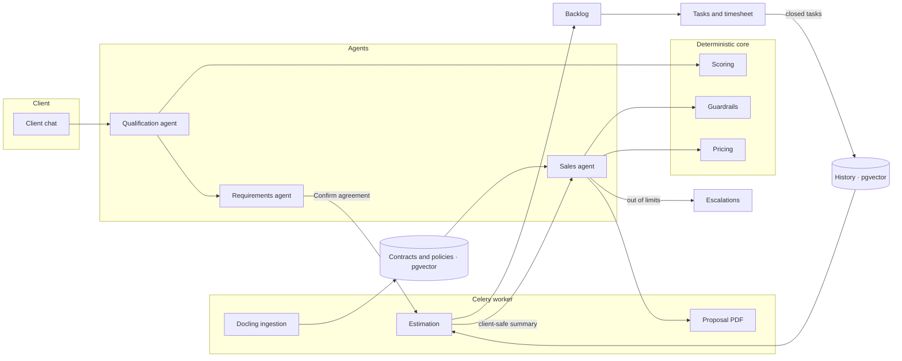

<p align="center">
  
</p>

# Holly Manager

**An AI Project Manager for software agencies: from the first client message to the last hour logged.**

Holly Manager does the work of a project manager across the whole life of a project. It talks to prospective clients and qualifies them. It turns the conversation into an agreed scope, then estimates, plans and prices the work. It negotiates the deal within the agency's rules and hands anything it can't settle to a human. Once the client agrees, it runs delivery: the backlog becomes the team's task board and time tracker. The forecast updates with every hour logged, and each project keeps its business logic documented with an assistant that answers from it.

It is built around one idea: **an LLM should talk, not decide.** The models extract information and break work down; every number a client sees (scores, hours, sprints, prices, payment schedules) comes from deterministic, tested code, and nothing outside the configured commercial limits is ever promised.

---

## Contents

- [Quick start](#quick-start)
- [Features](#features)
- [How it works](#how-it-works)
- [Architecture](#architecture)
- [Tech stack](#tech-stack)
- [Configuration](#configuration)
- [Project structure](#project-structure)
- [API overview](#api-overview)
- [Testing](#testing)
- [Observability](#observability)
- [Troubleshooting](#troubleshooting)
- [Roadmap](#roadmap)

---

## Quick start

### Prerequisites

- [Docker Desktop](https://www.docker.com/products/docker-desktop/) with Docker Compose v2
- About 10 GB of free disk space (the worker image includes Docling and the local models)
- At least one AI provider key (optional: without any, the local model is used): [Gemini](https://aistudio.google.com/apikey), [Anthropic (Claude)](https://console.anthropic.com/) or [OpenAI (Codex/GPT)](https://platform.openai.com/api-keys)

### 1. Configure

```bash
git clone <your-repo-url> holly-manager
cd holly-manager
cp .env.example .env
```

Open `.env` and set at least:

```bash
GEMINI_API_KEY=your-key-here        # and/or ANTHROPIC_API_KEY, OPENAI_API_KEY
SECRET_KEY=a-long-random-string
```

### 2. Start the stack

```bash
docker compose up -d --build                         # first build takes ~10-15 min
docker compose run --rm ollama-init                  # downloads the local models (first time only)
docker compose exec api python -m app.seed           # settings, history, documents and team accounts
```

Database migrations run automatically when the `api` container starts.

### 3. Open the app

Go to **http://localhost:5174** and sign in:

| Role | Email | Password | Lands on |
|---|---|---|---|
| Admin | `admin@holly.app` | `admin1234` | Clients, escalations, settings and the team views |
| Developer | `dev@holly.app` | `dev12345` | Dashboard, tasks, timesheet and reports |
| Client | Sign up at `/register` | — | The project chat |

### 4. Try the full flow (5 minutes)

1. **Sign up as a client** and answer the assistant's questions (company, budget, timeline, whether you decide). Once the score passes the threshold, the chat moves on to requirements.
2. **Describe a project**, for example: *"A web app so patients of our clinics can book and cancel appointments, with a confirmation email. Front-desk staff see the daily schedule and can block slots. GDPR compliant."* Watch the requirements document fill in on the right.
3. **Click "Confirm agreement"** when the summary appears. A few seconds later the chat shows the price, timeline and payment schedule.
4. **Negotiate:** ask for a 5% discount (accepted, the maximum is 10%), then ask for 40% (escalated to a person, never accepted by the agent). Ask *"When do invoices have to be paid?"* to get an answer with citations from the contract.
5. **Sign in as the developer:** the project now has a backlog. Drag tasks on the board, start the timer, log hours and watch the forecast update.
6. **Sign in as the admin:** answer the escalation, which then appears in the client's chat, and open the trace of any message in Jaeger.

> Change `COMPANY_NAME` in `.env` to rebrand everything the client sees (chat, agents and proposal PDF).

---

## Features

### For clients

- **Conversational onboarding:** a chat that qualifies the lead, then gathers requirements, with a progress stepper (Get to know you → Requirements → Estimate → Proposal).
- **Live requirements document:** epics, user stories with acceptance criteria, non-functional requirements, out-of-scope items and open questions, updated as the conversation goes on.
- **Explicit agreement:** the client confirms the summary with a button and it becomes an immutable, versioned record (SHA-256, protected by a database trigger).
- **Proposal and contract PDF:** generated on request, with the agreed scope, the commercial terms and the contract draft.

### For the team

| Section | What it does |
|---|---|
| **Dashboard** | Hours today and this week against a target, your next tasks, project health and recent team activity |
| **My tasks** | Every task across projects, filtered by assigned to me, unassigned or all, status, project and search |
| **Projects** | Project cards with progress, and inside each one a drag-and-drop **kanban board**, a **sprint** view, the **forecast** and the project's **docs** |
| **Project docs** | The project's business logic: a **business agreement** generated from the confirmed requirements (read-only, updated with every new version), **pages** the team writes in Markdown, uploaded files, and an assistant that answers only from that project's documentation |
| **Timesheet** | Weekly grid of tasks by day, navigation across weeks, and back-dated entries |
| **Reports** | Hours per person per week, estimation accuracy by task type (planned vs. actual) and deviation per project, each with a chart and a table view |
| **Task panel** | Status, assignee, the client story it comes from, dependencies, time entries with notes, and a **global timer** |
| **Documentation** | Built-in guides on how the system works, plus documents admins upload, with an **AI assistant** that answers only from the documentation and links every statement to the section it comes from |

### For admins

- **Clients:** every lead with its stage and qualification score, plus an internal view with the score breakdown (with the client's quotes), the full conversation trace (tools used, rules applied, violations, citations) and the internal estimate.
- **Escalations:** every request the agents could not resolve, with the client's exact words and the rule that blocked it. The reply goes straight to the client's chat.
- **Documentation:** upload team documents (Markdown, PDF, DOCX, HTML, PPTX), delete them, and resync the built-in guides from `backend/docs`.
- **Settings:** task types and hour ranges, team capacity and velocity, commercial rules (rate, minimum price, maximum discount, deposit, milestones, change rounds, support, risk margin), qualification criteria and weights, document uploads, and the **AI providers** chain (status of Gemini, Claude, Codex/GPT and the local model, with a test button per provider).

---

## How it works

### The guardrails

| Guarantee | How it is enforced |
|---|---|
| The LLM never invents a price | The sales agent can only call `propose_offer(discount, deposit, …)`. Code builds the price and payment schedule and validates them against the rules |
| Nothing outside the limits is accepted | An invalid offer is stored, escalated to a person, and the agent only receives `escalated`: it never learns the limits |
| No made-up figures in replies | Before sending, every reply is scanned for commercial figures (amounts, %, weeks, months, rounds). Any figure that does not come from a validated offer blocks the reply; the agent gets one retry, then a safe fixed message is sent and the case is escalated |
| Contract answers are grounded | If the agent searched the contract, the reply must cite the excerpts it used (`[C1]`, `[C2]`…) or it is blocked |
| Internal data stays internal | The sales agent only sees a `ClientSafeSummary`: no hours, hourly rate, risk margin or negotiation limits |

### Qualification

The LLM extracts evidence into a Pydantic model (budget, timeline, decision maker, company, email, need clarity), each with the client's literal quote. Code computes a weighted score and explains it, for example *"Score 72 because: budget covers the minimum (+30); company email (+10)…"*. The result is **qualified**, **nurture** or **discarded**, and only qualified leads move on.

### Estimation

A Celery task:

1. The LLM breaks each user story into typed tasks with dependencies, but no hours. The breakdown is validated and retried if it is invalid (unknown types, missing stories, cycles).
2. RAG finds similar tasks from past projects, with their actual hours.
3. Code computes a three-point PERT estimate per task, the P80, a risk margin, and assigns tasks to sprints by effective capacity in dependency order.
4. Code computes the price and the payment schedule.

### Documentation assistant

The built-in guides live as Markdown in [backend/docs/](backend/docs/) and are synced on seed (or with **Resync built-in guides**); only changed files are re-indexed. Uploads are converted to Markdown (Docling for PDF, DOCX, HTML and PPTX). Every document is split by heading, so each chunk knows its section path (for example *Estimation › Step 3: three-point estimate*).

When someone asks a question, the most relevant sections are retrieved and the model must cite them (`[C1]`, `[C2]`…). The same citation check used for the sales agent blocks any answer without valid citations: the model gets one retry, and otherwise the user is told the documentation doesn't cover it. Citations open the document at the exact section. Short follow-ups ("and what if…?") reuse the previous question for retrieval.

### Project documentation

Each project keeps its business logic next to its backlog. The **business agreement** page is generated from the latest confirmed requirements version (summary, epics and stories with acceptance criteria, NFRs, out of scope, and the decisions taken when resolving ambiguities) and regenerated whenever the client confirms a new version. The team adds **pages** (Markdown, edited in the app) and files. Everything is indexed with `kind="project"` and linked to the project, so the project assistant only retrieves that project's sections, never other projects or the system guides.

### Delivery and forecast

The estimate becomes the project backlog. Each time entry recalculates the forecast: the observed pace of closed tasks (actual ÷ planned) is applied to the open ones. If the forecast exceeds the committed hours by more than the configured threshold, the team gets an alert. Closed tasks are added to the RAG history, so the next estimate learns from real data.

---

## Architecture



| Service | Purpose | Host port |
|---|---|---|
| `web` | React app (Vite dev server) | 5174 |
| `api` | FastAPI + migrations on start | 8010 |
| `worker` | Celery: estimation, Docling ingestion, PDF, embeddings | — |
| `flower` | Celery monitoring | 5555 |
| `postgres` | PostgreSQL 17 + pgvector (HNSW indexes) | 5434 |
| `redis` | Celery broker and result backend | 6380 |
| `ollama` | Local fallback model and embeddings | 11600 |
| `jaeger` | OpenTelemetry traces | 16687 (UI), 4327 (OTLP) |

---

## Tech stack

| Layer | Technology |
|---|---|
| API | FastAPI, Pydantic v2, SQLAlchemy 2 (async), Alembic |
| Agents | LiteLLM router with a configurable fallback chain: Gemini, Claude (Anthropic), Codex/GPT (OpenAI) and a local Ollama model |
| RAG | pgvector (HNSW, cosine), `nomic-embed-text` embeddings, Docling for parsing and chunking |
| Background jobs | Celery + Redis, monitored with Flower |
| PDF | Jinja2 + WeasyPrint |
| Observability | OpenTelemetry → Jaeger |
| Auth | scrypt password hashing and HMAC-SHA256 signed tokens (standard library only) |
| Frontend | React 18, TypeScript, Vite, Tailwind CSS 4, TanStack Query, React Router, lucide icons |
| Tooling | uv, ruff, pytest |

---

## Configuration

All settings live in `.env` (see `.env.example`).

| Variable | Default | Description |
|---|---|---|
| `GEMINI_API_KEY` | — | Enables Gemini. Without any provider key only the local model is used |
| `PRIMARY_MODEL` | `gemini/gemini-3.8-flash` | Main model |
| `SECONDARY_MODEL` | `gemini/gemini-3.1-flash-lite` | Used when the primary is overloaded (leave empty to disable) |
| `ANTHROPIC_API_KEY` | — | Enables Claude |
| `CLAUDE_MODEL` | `anthropic/claude-sonnet-5-5` | Claude model |
| `OPENAI_API_KEY` | — | Enables Codex/GPT |
| `OPENAI_MODEL` | `openai/gpt-5` | Any OpenAI model your account has, for example a Codex model |
| `FALLBACK_MODEL` | `ollama_chat/qwen2.5:7b` | Local last resort |
| `LLM_CHAIN` | `gemini,gemini_secondary,claude,openai,ollama` | Fallback order. Providers without credentials are skipped |
| `EMBEDDING_MODEL` | `ollama/nomic-embed-text` | Single embeddings model for every vector |
| `EMBEDDING_DIM` | `768` | Vector size |
| `HISTORY_MIN_SIMILARITY` | `0.6` | Minimum similarity to use a past task in an estimate |
| `SECRET_KEY` | `dev-secret-change-me` | Signs session tokens. **Change it** |
| `COMPANY_NAME` | `Holly` | Name shown to clients |
| `PG_PORT`, `REDIS_PORT`, `API_PORT`, `WEB_PORT`, `FLOWER_PORT`, `OLLAMA_PORT`, `JAEGER_UI_PORT`, `OTLP_PORT` | see table above | Host ports |

Business rules (rates, discounts, milestones, team capacity, qualification weights, task types) are edited in the app under **Settings**, not in `.env`.

---

## Project structure

```
holly-manager/
├── docker-compose.yml
├── backend/
│   ├── app/
│   │   ├── agents/      # qualification, requirements, sales and documentation agents + tool loop
│   │   ├── api/         # REST endpoints (auth, admin, leads/chat, dev, docs, escalations)
│   │   ├── core/        # config, database, LLM client, telemetry, security
│   │   ├── domain/      # deterministic logic: scoring, estimation, scheduling, pricing, guardrails, forecast
│   │   ├── models/      # SQLAlchemy models
│   │   ├── rag/         # Docling ingestion, Markdown chunking, documentation sync and pgvector retrieval
│   │   ├── schemas/     # Pydantic domain models
│   │   ├── tasks/       # Celery tasks: estimation, ingestion, proposal PDF
│   │   ├── templates/   # proposal PDF template
│   │   └── seed.py      # demo settings, history, documents and accounts
│   ├── alembic/         # migrations
│   ├── docs/            # built-in documentation (Markdown) shown in the app and used by the assistant
│   ├── seed_docs/       # contract template and policies
│   └── tests/
└── frontend/
    ├── public/          # static assets served as-is (favicon.svg: the Holly mark)
    └── src/
        ├── components/  # UI kit, app shell, charts, task panel and timer
        └── pages/       # client chat, sign-in, admin pages and team/ views
```

---

## API overview

Interactive docs: **http://localhost:8010/docs**. Every endpoint except sign-in and sign-up needs `Authorization: Bearer <token>`.

| Area | Endpoints | Access |
|---|---|---|
| Auth | `POST /api/auth/register`, `POST /api/auth/login`, `GET /api/auth/me` | Public / signed in |
| Chat | `POST /api/leads/{id}/chat` (Server-Sent Events), `GET …/messages`, `GET …/state`, `POST …/requirements/confirm`, `GET …/proposals/{id}/pdf` | The client who owns it, or an admin |
| Leads (internal) | `GET /api/leads`, `GET /api/leads/{id}/internal/{messages,qualification,estimate}` | Admin |
| Tasks and time | `GET /api/dev/{dashboard,projects,tasks,team,timesheet,reports}`, `PATCH /api/dev/tasks/{id}`, `POST …/assign`, `POST …/time`, `DELETE /api/dev/time/{id}` | Developer, admin |
| Documentation | `GET /api/docs`, `GET /api/docs/{id}`, `POST /api/docs/ask` | Developer, admin |
| Documentation management | `POST /api/docs` (upload), `DELETE /api/docs/{id}`, `POST /api/docs/sync` | Admin |
| Project docs | `GET/POST /api/projects/{id}/docs`, `GET/PUT/DELETE …/docs/{doc}`, `POST …/docs/upload`, `POST …/docs/ask` | Developer, admin |
| Escalations | `GET /api/escalations`, `POST /api/escalations/{id}/resolve` | Admin |
| Settings | `GET/PUT /api/admin/{task-types,team,commercial,qualification}`, `GET/POST /api/admin/{documents,historical}` | Admin |

---

## Testing

```bash
docker compose up -d postgres
cd backend
uv sync
uv run pytest        # 82 tests
uv run ruff check .
```

| Suite | Covers |
|---|---|
| `test_scoring`, `test_estimation`, `test_forecast`, `test_pricing_guardrails` | The deterministic core: weighted scoring, PERT, sprint planning with dependencies and capacity, exact payment splits, every guardrail, figure detection in replies |
| `test_agents` | The agents with a scripted fake LLM against a real Postgres (`holly_test` database). It includes the difficult client: asking for 30% while the model tries to accept it, an invented deadline, a contract answer without a citation, and the immutability of the agreement |
| `test_api_roles` | Sign-in, role permissions, client isolation, task flow, timesheet, dashboard, reports and assignment |
| `test_llm_providers` | Chain order and validation, skipping providers without keys, status, per-provider tests and the admin endpoints |
| `test_project_docs` | The generated business agreement (content, decisions, refresh on new versions), team pages, project isolation in the assistant and the project docs API |
| `test_docs` | Markdown chunking, incremental sync of the built-in guides, the documentation assistant (cited answers, retries, invented citations, "not found"), follow-up detection, the LLM circuit breaker and the docs API permissions |

The tests never call a real model, so they are free and deterministic.

---

## Observability

Every chat turn is a `conversation.turn` span with nested `llm.*`, `tool.*` and `rag.*` spans. The rules applied, violations and tool calls are recorded as attributes. Each message stores its `trace_id`, and the admin's internal view links straight to the trace in **Jaeger (http://localhost:16687)**. Celery jobs can be followed in **Flower (http://localhost:5555)**.

---

## Troubleshooting

| Problem | Fix |
|---|---|
| `port is already allocated` | Another project is using that port: change it in `.env` (`API_PORT`, `PG_PORT`, …) |
| Ollama cannot bind its port on Windows | Windows reserves some port ranges (`netsh interface ipv4 show excludedportrange protocol=tcp`). Pick a free `OLLAMA_PORT` |
| A provider returns errors (e.g. Gemini `503 high demand`) or is very slow | Each remote call times out after 30 s and moves to the next provider in `LLM_CHAIN`. Check **Settings → AI providers** and use **Test** to see which ones respond. A model that just failed is skipped for 5 minutes, so only the first request pays the wait. Make sure `ollama-init` has run |
| `model 'qwen2.5:7b' not found` | Run `docker compose run --rm ollama-init` (or `docker exec holly-manager-ollama-1 ollama pull qwen2.5:7b`) |
| Documents stay `pending` | The first Docling run downloads its models; check `docker compose logs worker` |
| Code changes don't show up | Backend code is mounted: run `docker compose restart api worker`. The frontend reloads on its own |
| The tab still shows the old icon | Run `docker compose up -d web` once so the container mounts `frontend/public`, then hard-refresh (browsers cache favicons) |

---

